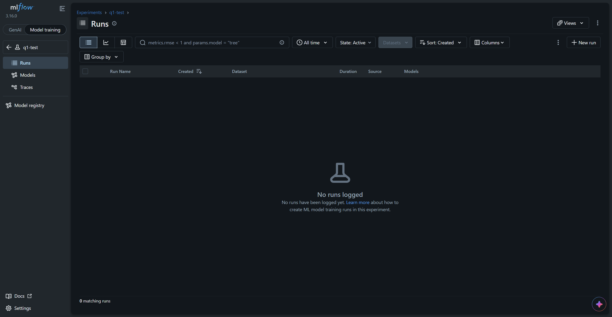
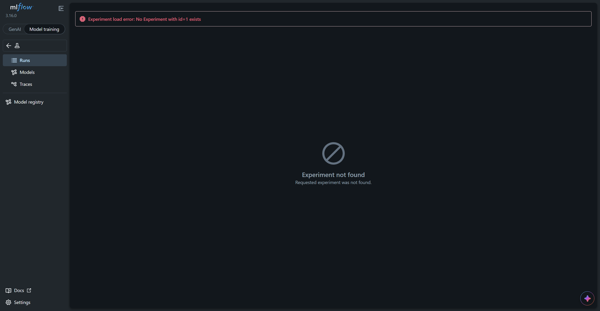
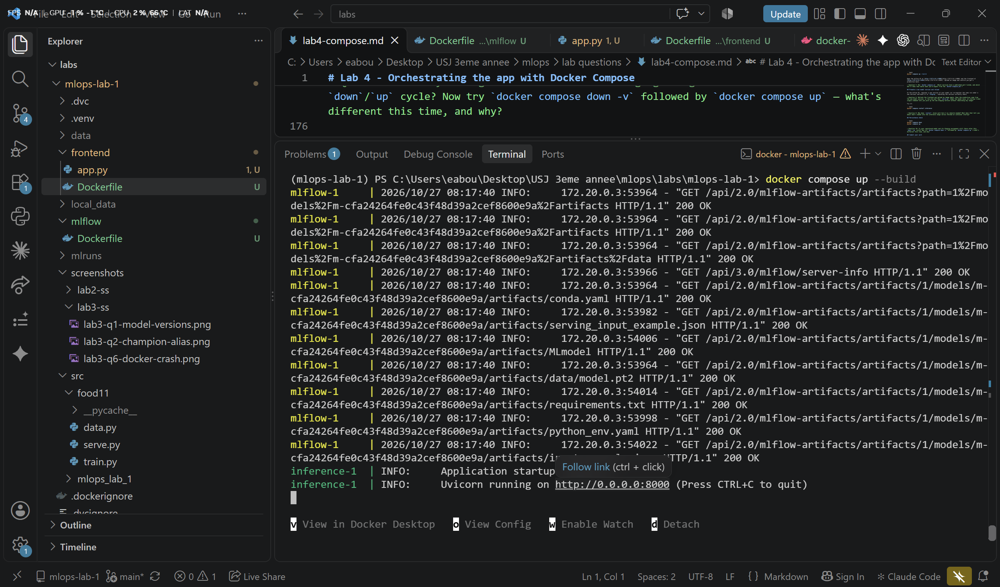
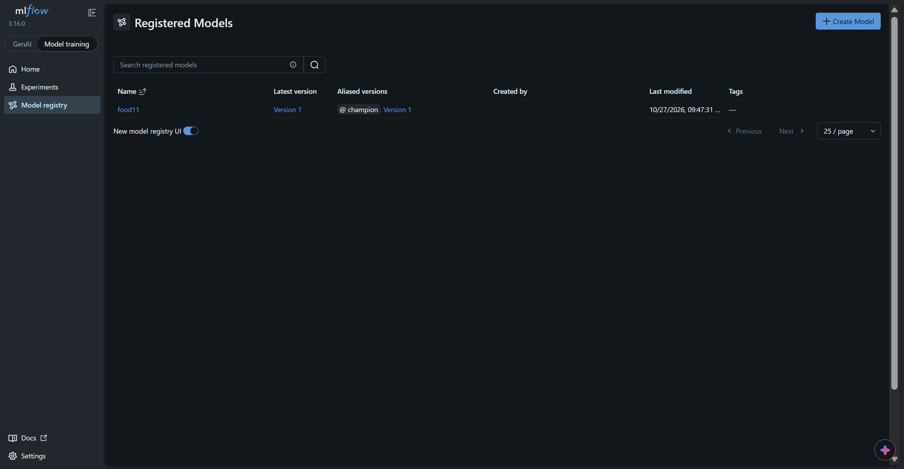
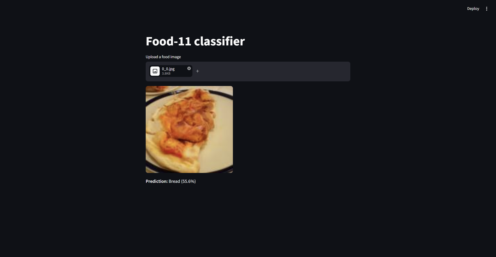
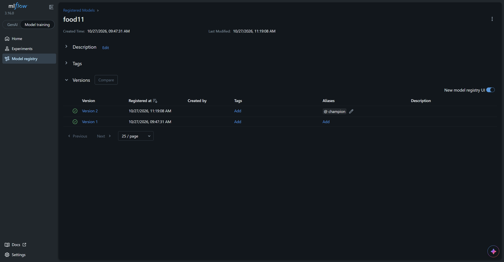
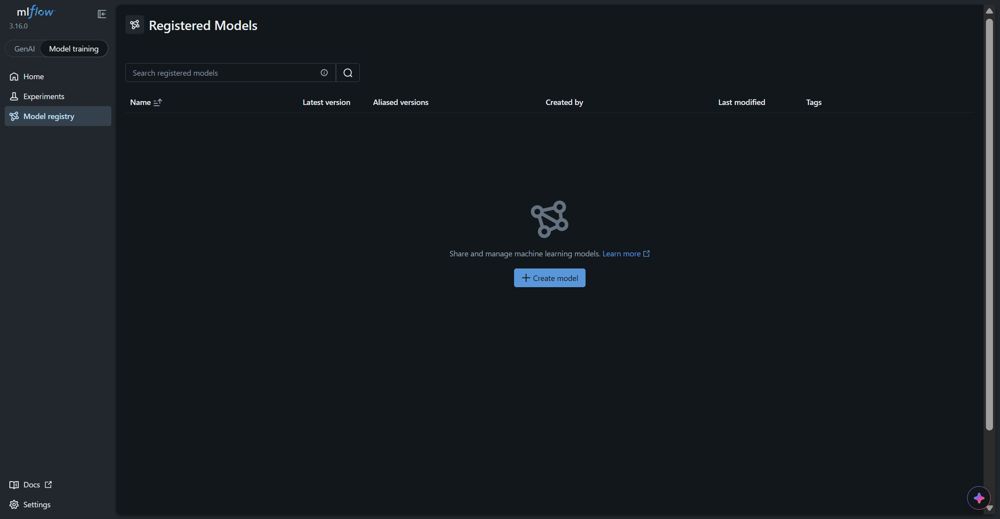

# Lab 4 - Answers

> **Matricule:** 231833
> **Full Name:** Naji Bou Zeid
> **Group:** MLOps grp 7
> **Date:** 27-10-2026

## Notes on the Setup

A few adjustments were needed compared to the lab text (Windows + Docker Desktop, mlflow 3.16):

- **`mlflow/Dockerfile`:**
  - `mlflow==3.16.0` is pinned, to match the client version used by `train.py` and the inference image.
  - `--artifacts-destination /mlflow-data/mlruns` is used instead of `--default-artifact-root`. With a plain local artifact root, the server hands clients a file path inside its own container, which the inference container cannot read (the same `No such artifact` problem as in Lab 3). With `--artifacts-destination`, artifacts are stored on the volume and served over HTTP.
  - `--allowed-hosts "mlflow:5000,localhost:5000,127.0.0.1:5000"` is added, because mlflow 3's security middleware rejects unknown `Host` headers, including `mlflow:5000`.
  - `RUN mkdir -p /mlflow-data` is added, so the image can also run standalone without a volume (Question 1).
- **Staging → `champion` alias:** model stages are deprecated in current mlflow (as noted in Lab 3), and `serve.py` loads `models:/food11@champion`. Wherever the lab says "move to Staging", the `champion` alias was moved instead.
- **Fresh registry:** the containerized mlflow starts with an empty database on its volume, so the model was trained again against it (`useful-mouse-595`, same settings as the best Lab 2 run: `lr=0.0001`, `batch_size=32`, `epochs=5`), registered as `food11` version 1 and given the `champion` alias.

## Question 1: What happens to everything written to `/mlflow-data` if you never mount a volume there and just `docker run` this image standalone? Try it: run the container, register nothing, stop it, remove it, start a new one from the same image — what do you see in the UI?

Without a volume, `/mlflow-data` is just a folder in the container's writable layer, so the database and artifacts live and die with that one container. Test, with the Compose mlflow stopped to free port 5000:

```
PS ...\mlops-lab-1> docker compose stop mlflow
PS ...\mlops-lab-1> docker run -d --name mlflow-q1 -p 5000:5000 mlops-lab-1-mlflow
```

An experiment `q1-test` was created in the UI of this first container:



Then the container was removed and a new one started from the same image:

```
PS ...\mlops-lab-1> docker stop mlflow-q1
PS ...\mlops-lab-1> docker rm mlflow-q1
PS ...\mlops-lab-1> docker run -d --name mlflow-q1 -p 5000:5000 mlops-lab-1-mlflow
```

Refreshing the same page now fails, because the new container's database has never seen that experiment:



Everything written to `/mlflow-data` was deleted together with the first container. The image only contains the mlflow installation, never the data written at runtime, so every new container from it starts empty.

## Question 2: Why a named volume here instead of a bind mount to a folder in your repo (the way you might for local dev)? Would a bind mount work just as well?

A named volume is created and managed by Docker, independent of any host path. The compose file works the same on any machine, and the data stays out of the repo folder, so the mlflow database and model files can't be committed to git by accident (the risk handled with `.gitignore` in Lab 2). On Docker Desktop for Windows, a named volume also lives inside the Linux VM, which avoids slow file access and file-locking problems that SQLite can have on a bind-mounted Windows folder.

A bind mount would work for local development, and it is easier to inspect, since the files appear directly in the project folder. But it ties the setup to one specific host path, the same kind of dependency that caused the Windows-path problems in Lab 3, and it mixes runtime data with source code. For data the application owns, like mlflow's database and artifacts, a named volume is the better fit.

## Question 3: In Lab 3 you had to use `host.docker.internal` or `--network host` to reach mlflow from inside the container. In this lab, `MLFLOW_TRACKING_URI` will simply be `http://mlflow:5000`. Why does that hostname resolve now when it didn't before?

`docker compose up` creates a private network for the project and attaches every service to it. Compose's embedded DNS then resolves each **service name** to that service's container IP. In Lab 3, mlflow was not a container at all; it ran on the host, and the inference container sat on Docker's default network, where no container or service named `mlflow` existed. The only way out was `host.docker.internal`.

The mlflow server log shows the inference container reaching mlflow by name over the Compose network. Every request comes from `172.20.0.3`, the inference container's address on that network, and downloads the model files over HTTP:

```
mlflow-1     | INFO:     172.20.0.3:53964 - "GET /api/2.0/mlflow-artifacts/artifacts/1/models/m-cfa24264fe0c43f48d39a2cef8600e9a/artifacts/MLmodel HTTP/1.1" 200 OK
mlflow-1     | INFO:     172.20.0.3:53964 - "GET /api/2.0/mlflow-artifacts/artifacts/1/models/m-cfa24264fe0c43f48d39a2cef8600e9a/artifacts/data/model.pt2 HTTP/1.1" 200 OK
inference-1  | INFO:     Application startup complete.
inference-1  | INFO:     Uvicorn running on http://0.0.0.0:8000 (Press CTRL+C to quit)
```



The name only resolves while the mlflow container is running. With it stopped (Question 6), the same lookup fails with `Failed to resolve 'mlflow'`.

## Question 4: Why does the frontend read `INFERENCE_URL` from an environment variable instead of hardcoding `http://inference:8000`? Think about what happens if you ever `docker run` this frontend image on its own, outside Compose.

The name `inference` only exists on the Compose network. Run on its own with `docker run`, the frontend container would be on Docker's default network, where `inference` doesn't resolve, so every upload would fail with a connection error. Reading the URL from an environment variable keeps the image the same everywhere: Compose sets `INFERENCE_URL=http://inference:8000`, a standalone run can pass `-e INFERENCE_URL=http://host.docker.internal:8000`, and running `app.py` directly on the host uses the default `http://127.0.0.1:8000`. Only the configuration changes, not the image. This is the same reason `serve.py` reads `MLFLOW_TRACKING_URI` from the environment.

## Question 5: Only `mlflow` and `frontend` publish a port to the host. `inference` doesn't. Why not, and how does the frontend still reach it?

A port only needs to be published if a human on the host must reach it directly: the browser opens the frontend (8501), and the mlflow UI (5000) is used to register models and move aliases. The inference API is only called by the frontend, and that traffic stays inside the Compose network, where every container can reach every other container on any port it listens on. The frontend calls `http://inference:8000` by service name, and uvicorn listens on port 8000 inside the inference container. Not publishing it also means the API isn't exposed on the host machine at all.

```
PS ...\mlops-lab-1> docker compose ps
NAME                      IMAGE                   COMMAND                  SERVICE     CREATED         STATUS         PORTS
mlops-lab-1-frontend-1    mlops-lab-1-frontend    "streamlit run app.p…"   frontend    8 minutes ago   Up 8 minutes   0.0.0.0:8501->8501/tcp, [::]:8501->8501/tcp
mlops-lab-1-inference-1   mlops-lab-1-inference   "uvicorn src.food11.…"   inference   8 minutes ago   Up 8 minutes   8000/tcp
mlops-lab-1-mlflow-1      mlops-lab-1-mlflow      "mlflow server --hos…"   mlflow      8 minutes ago   Up 8 minutes   0.0.0.0:5000->5000/tcp, [::]:5000->5000/tcp
```

## Question 6: `depends_on` here only waits for the mlflow *container process* to start, not for the tracking server inside it to be ready to accept connections. If your `serve.py` tries to load the Staging model at startup and mlflow isn't ready yet, what happens to the `inference` container? Look at `docker compose logs inference` if it fails.

In normal startups the inference service won the race: it needs several seconds just to import torch and mlflow, and the mlflow client retries failed requests before giving up. To see the failure case, the inference service was started while mlflow was not running:

```
PS ...\mlops-lab-1> docker compose stop mlflow
PS ...\mlops-lab-1> docker compose restart inference
PS ...\mlops-lab-1> docker compose logs inference
inference-1  | INFO:     Started server process [1]
inference-1  | INFO:     Waiting for application startup.
inference-1  | ERROR:    Traceback (most recent call last):
...
inference-1  | urllib3.exceptions.NameResolutionError: HTTPConnection(host='mlflow', port=5000): Failed to resolve 'mlflow' ([Errno -2] Name or service not known)
...
inference-1  | mlflow.exceptions.MlflowException: API request to http://mlflow:5000/api/2.0/mlflow/registered-models/alias failed with exception HTTPConnectionPool(host='mlflow', port=5000): Max retries exceeded with url: /api/2.0/mlflow/registered-models/alias?name=food11&alias=champion (Caused by NameResolutionError(...))
inference-1  |
inference-1  | ERROR:    Application startup failed. Exiting.
```

`serve.py` loads the model at startup, so when it can't reach mlflow, the startup fails and uvicorn exits. With no restart policy, the container stays stopped: it disappeared from `docker compose ps`, while the frontend kept running and would get connection errors on every upload. It came back only after mlflow was started and the inference service was started again (`docker compose up -d`).

Ways to make this robust: a `healthcheck` on the mlflow service combined with `depends_on: condition: service_healthy`, a `restart: on-failure` policy on the inference service, or a retry loop in `serve.py` before loading the model.

## Question 7: Run `docker compose ps`. Which services have a published port listed, and which don't? Does that match what you'd expect from the `docker-compose.yml`?

From the `docker compose ps` output in Question 5:

| Service | Ports column | Published to the host? |
|---|---|---|
| `frontend` | `0.0.0.0:8501->8501/tcp` | Yes |
| `mlflow` | `0.0.0.0:5000->5000/tcp` | Yes |
| `inference` | `8000/tcp` | No, only reachable inside the Compose network |

This matches the `docker-compose.yml`: only `mlflow` and `frontend` have a `ports:` section. `inference` shows `8000/tcp` without a host mapping because the image declares `EXPOSE 8000`, which only documents the port without publishing it.

## Question 8: Refresh the frontend and upload an image again. Does the prediction come from the new model version, or the old one? Your `serve.py` loads the model once, at startup — what single command lets you pick up the new Staging version without rebuilding any image?

With version 1 holding `champion`, the frontend returned **Fried food (97.3%)** for `validation/Bread/0_0.jpg`:




A second model was trained with a different learning rate (`youthful-ape-788`, `lr=0.001`), registered as version 2, and the `champion` alias was moved to it:

```
Epoch 5/5 - train_loss: 0.4104 - val_loss: 1.6582 - val_accuracy: 0.5575
Final test_accuracy: 0.5830
🏃 View run youthful-ape-788 at: http://127.0.0.1:5000/#/experiments/1/runs/7fb070b3ba0c420589952cefa1cf1a6d
```


Refreshing the frontend and uploading again still gave the **old** prediction, from version 1. `serve.py` resolves the alias and loads the model once at startup, so the running process keeps version 1 in memory no matter where the alias points now. The single command that picks up the new version is:

```
docker compose restart inference
```

After the restart, the same image returned **Bread (55.6%)**, the prediction of version 2:



Version 2 is the worse model overall (test accuracy 0.5830 vs 0.7518) and would not be promoted in practice. It was used here because its predictions differ visibly from version 1's, which makes the switch easy to see.

## Question 9: Why does `restart` alone work here — no rebuild needed? What does that tell you about what's baked into the inference image versus fetched at container startup?

The image contains the code and its environment (Python, the dependencies in `.venv`, `serve.py`), but not the model. The model is fetched at container startup: `serve.py` asks mlflow which version `champion` points to, then downloads that version's files over HTTP. `restart` stops and starts the same container, which runs that startup again, resolves the alias again and gets version 2. Nothing inside the image changed, so nothing needed rebuilding. Promoting a model is a registry operation (moving an alias), not a deployment of new code.

## Question 10: Is your registered model and its Staging assignment still there after this `down`/`up` cycle? Now try `docker compose down -v` followed by `docker compose up` — what's different this time, and why?

After `docker compose down` and `docker compose up -d`, both versions are still there and `champion` still points to version 2:



`down` removes the containers and the project network, but keeps named volumes, so the new mlflow container mounted the same `mlflow-data` volume with the same database and artifacts. The inference service started normally and loaded version 2.

After `docker compose down -v` and `docker compose up -d`, the registry is empty:



`-v` also deletes the named volumes declared in the compose file, so `mlflow-data` was destroyed and the new mlflow container created a fresh, empty database. The inference service could no longer find its model and exited:

```
PS ...\mlops-lab-1> docker compose logs inference --tail 20
...
inference-1  | mlflow.exceptions.RestException: RESOURCE_DOES_NOT_EXIST: Registered Model with name=food11 not found
inference-1  |
inference-1  | ERROR:    Application startup failed. Exiting.
```

To get a working stack again, the model was retrained against the fresh mlflow (`bright-colt-77`), registered as `food11` version 1 and given the `champion` alias.

## Question 11: This compose file is still meant to run on one machine. What would have to change for the `inference` service to run as three replicas behind a load balancer, or for the mlflow service to survive a machine failure? (You don't need to implement this — just name what Docker Compose can't give you here.)

The missing pieces are:

- **Multiple machines and scheduling.** Compose runs all services on a single Docker host. If that machine fails, everything stops. Running across several machines, and moving containers to a healthy machine on failure, needs an orchestrator such as Kubernetes.
- **Real load balancing and health-based routing.** Compose can start several copies of a service on one host (`docker compose up --scale inference=3`), but there is no load balancer that checks replica health and only routes traffic to healthy ones. In Kubernetes, this is a Deployment with `replicas: 3` behind a Service, with readiness and liveness probes.
- **Rolling updates and self-healing.** A new image version should replace replicas one by one without downtime, and crashed replicas should be restarted automatically. Compose has none of this beyond basic restart policies.
- **mlflow state that doesn't live on one machine.** The registry is currently SQLite on a local Docker volume, which exists only on that host. Surviving a machine failure needs the database moved to a managed, replicated database (for example PostgreSQL), and the artifacts to object storage (for example S3 or MinIO). The mlflow server itself then becomes stateless and can run as several replicas on different machines.
