# Lab 5 - Answers

> **Matricule:** 231833
> **Full Name:** Naji Bou Zeid
> **Group:** MLOps grp 7
> **Date:** 15-11-2026

## Notes on the Setup

A few adjustments were needed compared to the lab text (Windows + PowerShell, mlflow 3.16, current ruff):

- **CPU-only torch:** `pyproject.toml` points `torch` and `torchvision` to the PyTorch CPU index, so `uv sync` in CI downloads the ~200 MB CPU wheel instead of the multi-GB CUDA build:
  ```toml
  [[tool.uv.index]]
  name = "pytorch-cpu"
  url = "https://download.pytorch.org/whl/cpu"
  explicit = true

  [tool.uv.sources]
  torch = { index = "pytorch-cpu" }
  torchvision = { index = "pytorch-cpu" }
  ```
- **Imports in tests:** `[tool.pytest.ini_options] pythonpath = ["."]` was added, so `from src.food11... import ...` resolves from the repo root.
- **Ruff:** the current default rule set flagged 4 errors in the Lab 1–4 code, all fixed: unsorted imports in `data.py` (I001), `File(...)` as a default argument in `serve.py` (B008, replaced by `file: Annotated[UploadFile, File()]`), `import torch.nn as nn` (PLR0402, replaced by `from torch import nn`) and an unused `test_loss` (RUF059, renamed `_test_loss`). The repo's `mlflow/` folder (the Lab 4 Dockerfile) made ruff treat the `mlflow` package as first-party, so `[tool.ruff.lint.isort] known-third-party = ["mlflow"]` was added. For the same reason, the imports in the test files are sorted slightly differently from the lab text.
- **Image name:** the GitHub username has capital letters, so the image is tagged `ghcr.io/najibouzeid/mlops-lab-1:${{ github.sha }}` instead of `ghcr.io/${{ github.repository }}`.
- **Branch protection:** a ruleset (`lab5`, Active, target = default branch, empty bypass list) was used instead of a classic rule.
- **Registering models:** in mlflow 3 a registered version is created from the logged model, so v2 and v3 were registered with `mlflow.register_model("runs:/<run_id>/model", "food11")`.

Final `.github/workflows/ci.yml`:

```yaml
name: ci

on:
  push:
  pull_request:

jobs:
  test:
    runs-on: ubuntu-latest
    steps:
      - uses: actions/checkout@v4
      - uses: astral-sh/setup-uv@v5
        with:
          enable-cache: true
          prune-cache: false
          cache-suffix: "full"
      - run: uv sync --frozen
      - run: uv run ruff check src tests
      - run: uv run pytest -q

  smoke:
    needs: test
    runs-on: ubuntu-latest
    steps:
      - uses: actions/checkout@v4
      - run: docker build -t food11-api:ci .
      - name: start the container without a model and probe it
        run: |
          docker run -d --name api -p 8000:8000 -e SKIP_MODEL=1 food11-api:ci
          for i in $(seq 1 20); do
            curl -sf localhost:8000/health && exit 0
            sleep 2
          done
          docker logs api
          exit 1

  push:
    needs: smoke
    if: github.ref == 'refs/heads/main'
    runs-on: ubuntu-latest
    permissions:
      contents: read
      packages: write
    steps:
      - uses: actions/checkout@v4
      - uses: docker/setup-buildx-action@v3
      - uses: docker/login-action@v3
        with:
          registry: ghcr.io
          username: ${{ github.actor }}
          password: ${{ secrets.GITHUB_TOKEN }}
      - uses: docker/build-push-action@v6
        with:
          context: .
          push: true
          tags: ghcr.io/najibouzeid/mlops-lab-1:${{ github.sha }}
          cache-from: type=gha
          cache-to: type=gha,mode=max
```

## Question 1: Why is it a bad idea for a unit test to load the real model from your MLflow server? List at least two ways the test could fail even though your code is correct.

A unit test should check one piece of code, quickly and with the same result every time. Loading the real model ties the result to an external server, the network and whatever the registry contains at that moment. Ways it can fail with correct code:

- **No server reachable:** the CI runner has no MLflow server. `http://127.0.0.1:5000` points at the runner itself, so `load_model` raises a connection error. The same happens on a laptop where the Compose stack is not running.
- **Registry state changed:** the `champion` alias was moved, deleted, or the registry was wiped (as with `docker compose down -v` in Lab 4). `models:/food11@champion` then fails to resolve, or resolves to a different model whose prediction for `bread.jpg` is no longer "Bread".
- **Model behaviour:** a correct pipeline can still give a wrong or low-confidence prediction from a real model. The test would then fail because of model quality, not code.
- **Slowness and size:** every test run would download hundreds of MB of artifacts and need torch with enough memory. That turns a sub-second test into a minutes-long one that can time out.

## Question 2: The fake model always answers "Bread" with 0.90 confidence. What exactly does `test_predict_returns_valid_json` prove, and what does it *not* prove?

```
(mlops-lab-1) PS ...\mlops-lab-1> uv run ruff check src tests; uv run pytest -q
All checks passed!
.....                                                                    [100%]
...
5 passed, 4 warnings in 34.28s
```

It proves that the serving code around the model works:
- the app starts with `SKIP_MODEL=1` without contacting MLflow
- `/predict` accepts a multipart upload and decodes a real JPEG
- the preprocessing produces an input that can be passed to `model.predict` without crashing
- the model output is turned into the right response: index 0 is mapped to `"Bread"`, and the JSON has a `category` and a `confidence` between 0 and 1

It does not prove:
- that the real model gives correct predictions (the fake ignores its input)
- that the preprocessing matches what the model saw at training time (size, normalization, channel order)
- that the real pyfunc model returns the same output format as the fake (a list here, maybe a numpy array or DataFrame in reality)
- that the model can be loaded from MLflow at all

`serve.py` applies a softmax to the model output, so the returned confidence here is about 0.20, not 0.90. The test still passes because it only checks the range, not the exact value.

## Question 3: Which check caught it? Why is a train/test duplicate more dangerous than a corrupted image, even though the corrupted image makes the training script crash and the duplicate does not?

Check 4 (no image in two splits) caught it. The injected copy is the first pair listed:

```
(mlops-lab-1) PS ...\mlops-lab-1> Copy-Item data\food11_processed_mini\training\Bread\0_0.jpg data\food11_processed_mini\evaluation\Bread\0_0_dup.jpg
(mlops-lab-1) PS ...\mlops-lab-1> uv run python src/food11/validate_data.py data/food11_processed_mini
Data contract for data\food11_processed_mini
[PASS] 1. 11 class folders per split
[PASS] 2. images open, RGB, 128x128
[PASS] 3. at least 50 images per class
[FAIL] 4. no image in two splits
       - same image in several splits: evaluation\Bread\0_0_dup.jpg, training\Bread\0_0.jpg
       - same image in several splits: evaluation\Bread\0_131.jpg, training\Bread\0_106.jpg
       - same image in several splits: evaluation\Bread\0_139.jpg, training\Bread\0_186.jpg
       - same image in several splits: training\Dairy product\1_185.jpg, validation\Dairy product\1_123.jpg
       - same image in several splits: training\Dessert\2_1046.jpg, validation\Dessert\2_154.jpg
       - same image in several splits: evaluation\Fried food\4_123.jpg, training\Fried food\4_167.jpg
       - same image in several splits: evaluation\Bread\0_13.jpg, validation\Bread\0_11.jpg
       - same image in several splits: evaluation\Bread\0_138.jpg, validation\Bread\0_129.jpg
       - same image in several splits: evaluation\Bread\0_17.jpg, validation\Bread\0_150.jpg
       - same image in several splits: evaluation\Bread\0_149.jpg, validation\Bread\0_152.jpg
       ... and 34 more
[PASS] 5. class shares train vs val within 0.05
(mlops-lab-1) PS ...\mlops-lab-1> Remove-Item data\food11_processed_mini\evaluation\Bread\0_0_dup.jpg
```

The other duplicates were already there: without the injected copy, the clean mini dataset fails the same check with 43 groups of identical files across splits, and the full `food11_processed` dataset with 611. The Food-11 source data contains byte-identical images in different splits. The test accuracies of Labs 2–4 are therefore slightly optimistic. The dataset was left unchanged so the lab results stay comparable.

A corrupted image fails loudly: training crashes, someone looks at it and fixes it. A train/test duplicate fails silently: everything runs, and the model is evaluated partly on images it memorized, so `test_accuracy` is inflated. Every decision based on that number (which run is best, whether to promote a model with the quality gate, whether it is good enough to ship) is then made on a wrong measurement, and the error only shows up in production, as accuracy lower than expected.

## Question 4: Your CI runner cannot see your data (it is in DVC, and maybe in a local remote). Where in your workflow should `validate_data.py` run so that it still protects you? Give two places.

1. **On the machine that has the data, before it is used or shared:** as the first stage of the DVC pipeline (`dvc repro` runs `validate_data.py` before `train.py`, and stops if it exits 1), or in a git pre-commit hook that runs it whenever a `.dvc` file changes. Bad data then never reaches training, and never gets pushed with `dvc push`.
2. **In CI, after pulling the data from a remote the runner can reach:** the DagsHub remote is reachable from GitHub. A dedicated job stores the DagsHub token as a repository secret, runs `dvc pull` and then `validate_data.py`. It can be limited to pushes that change `*.dvc` files or `dvc.lock`, so the download only happens when the data version changes.

## Question 5: The `smoke` job has `needs: test`. What happens to it if a unit test fails? What would happen without `needs`?

With `needs: test`, `smoke` only starts after `test` succeeds. If a unit test fails, `smoke` is **skipped**, and so is `push`, which needs `smoke`. This is visible on the pull request in Question 9: `test` failing, `smoke` and `push` skipped.

Without `needs`, jobs run in parallel on separate runners. `smoke` would build and start the image even when the tests fail, which wastes about 1.5 minutes of runner time. The order would also no longer be guaranteed, so a `push` job depending only on `smoke` could publish an image whose code fails its unit tests.

## Question 6: How long did the whole run take? Run it a second time (push an empty commit with `git commit --allow-empty -m "ci"`) and compare. Which step got faster, and why?

First run (commit `e59153d`): **1m 54s** in total.

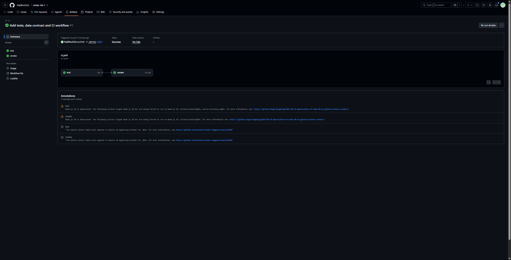

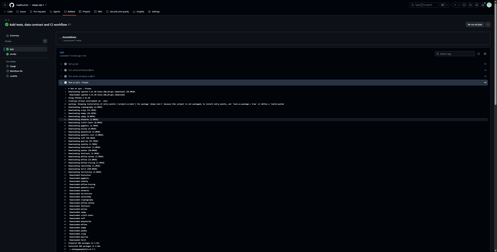

Second run (empty commit `ci`): **2m 2s**. Nothing got faster:

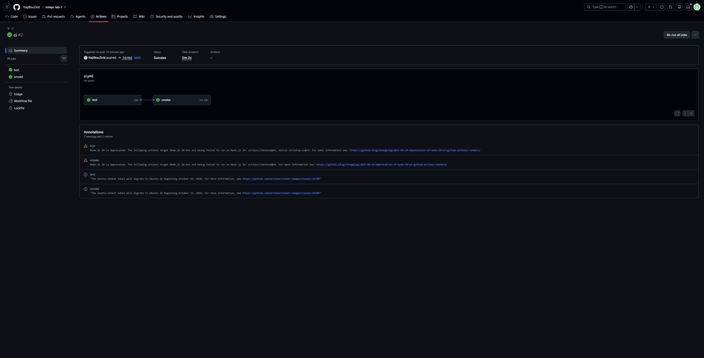

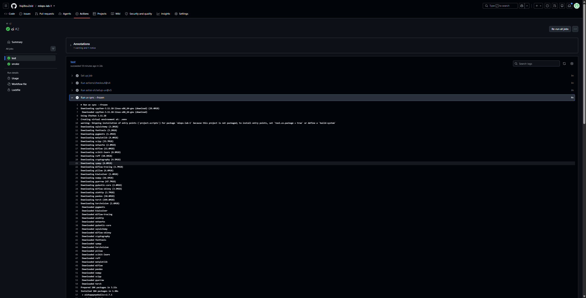

`uv sync` still downloaded every package (`Prepared 104 packages`). `setup-uv` does save its cache, but by default it **prunes** downloaded wheels before saving, because re-downloading them from PyPI is usually as fast as restoring them from the GitHub cache. The `smoke` job has no cache at all: `docker build` starts from an empty runner and rebuilds every layer.

To see a real cache hit, the cache was saved unpruned (`prune-cache: false`). A new key (`cache-suffix: "full"`) was needed, because GitHub never overwrites an existing cache entry. One run filled the cache, and the next empty commit (`ci: cached run`) used it:

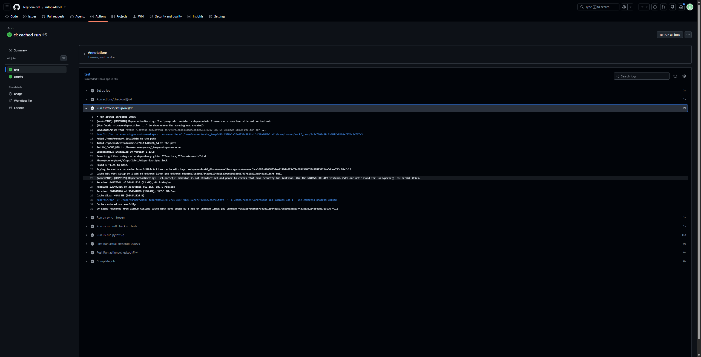

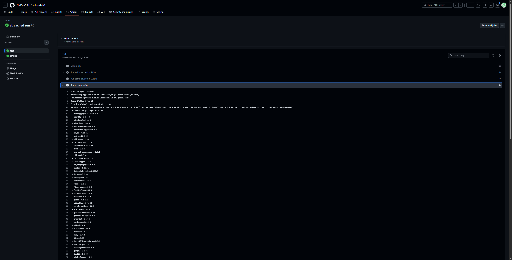

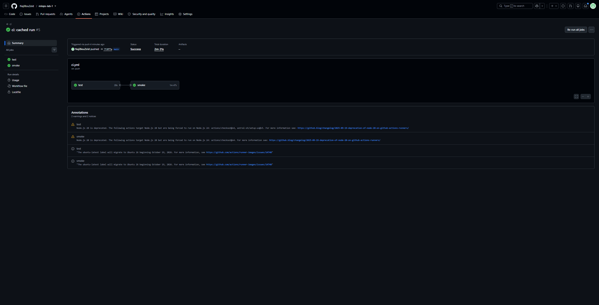

| | Run 1 | Run 2 (pruned cache) | Cached run |
|---|---|---|---|
| `setup-uv` | – | – | 7s (restores ~348 MB) |
| `uv sync --frozen` | 6s, downloads 104 packages | 6s, downloads 104 packages | **2s**, no package download |
| `test` job | 24s | 24s | 28s |
| `smoke` job | 1m 25s | 1m 32s | 1m 47s |
| Total | 1m 54s | 2m 2s | 2m 21s |

Only `uv sync` got faster (6s → 2s), because the wheels came from the restored cache instead of PyPI. The `test` job as a whole did not get faster: restoring 348 MB took about as long as downloading it. The total is dominated by `smoke`, whose uncached `docker build` varies between runs. The real gain would come from caching the Docker layers, as the `push` job does with `cache-from/cache-to: type=gha`.

## Question 7: This answers Question 9 of Lab 3. Why tag with the commit SHA rather than `latest`? Describe a concrete situation where `latest` leads two machines to run different code.

The `push` job runs only on `main`, after `test` and `smoke`:

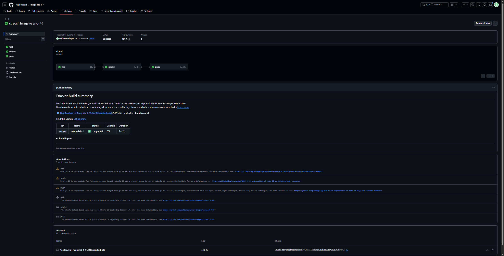

The image appears under Packages, tagged with the full commit SHA:

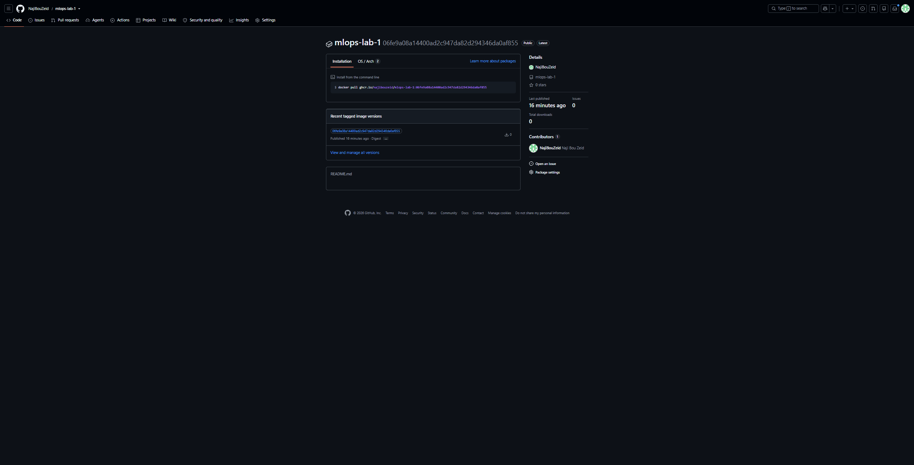

```
(mlops-lab-1) PS ...\mlops-lab-1> docker pull ghcr.io/najibouzeid/mlops-lab-1:06fe9a08a14400ad2c947da82d294346da0af855
06fe9a08a14400ad2c947da82d294346da0af855: Pulling from najibouzeid/mlops-lab-1
44136fa355b3: Already exists
1cc801e17bdb: Pull complete
d751b36c794a: Pull complete
8a1114ebbbae: Pull complete
1205345342d8: Download complete
Digest: sha256:df11b7121d54a74df67c6c7c68f9a48ff23b3925a70111c22adf49dc35bccadd
Status: Downloaded newer image for ghcr.io/najibouzeid/mlops-lab-1:06fe9a08a14400ad2c947da82d294346da0af855
ghcr.io/najibouzeid/mlops-lab-1:06fe9a08a14400ad2c947da82d294346da0af855
```

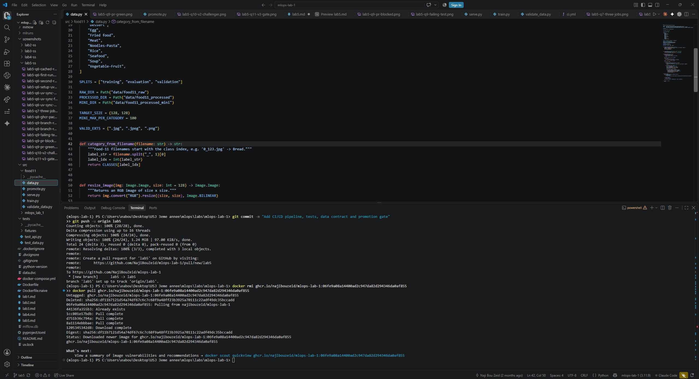

A SHA tag is immutable and traceable: `06fe9a0...` always means exactly that commit, so the running code can be found in git, reproduced, and rolled back by pulling the previous SHA. `latest` is a moving pointer that every push to `main` reassigns, so the tag alone says nothing about which code is inside.

Example: server A runs `docker pull ...:latest` on Monday and gets commit X. On Tuesday a PR that changes the preprocessing in `serve.py` is merged, and CI pushes commit Y as `latest`. On Wednesday server B is added behind the same load balancer and pulls `latest`, getting Y. Both servers report running `latest`, but A preprocesses images the old way and B the new way, so the same photo gets different predictions depending on which server answers. Docker does not re-pull an image whose tag already exists locally, so A stays on X until someone pulls explicitly. With SHA tags, the deployment names the exact version, and both servers run the same one.

## Question 8: Why does the `push` job declare `permissions:` explicitly? What could a compromised step do with a token that had write access to everything in the repo?

`GITHUB_TOKEN` gets whatever default permissions the repository or organization is configured with, which can be write access on most scopes. Declaring `permissions:` applies least privilege: this job only needs to read the code (`contents: read`) and publish an image (`packages: write`), so the token gets nothing else. Every other scope is set to none.

Each `uses:` runs third-party code with that token, and an action can be compromised upstream (a malicious version pushed under an existing tag, as happened with `tj-actions/changed-files` in 2025). With write access to everything, a compromised step could:
- push commits to branches, inject a backdoor into the code, or move tags and create releases
- approve, merge or close pull requests and modify issues
- delete branches or overwrite published packages, replacing the image under a trusted SHA tag with a malicious one
- exfiltrate the token to keep acting on the repo until the run ends

With `contents: read` and `packages: write`, the damage is limited to the package registry. Pinning actions to a commit SHA instead of `@v4` would reduce the risk further.

## Question 9: What does the pull request page show? Could you still merge? What does that change for a team compared to "everybody runs the tests on their laptop before pushing"?

The ruleset on `main`:

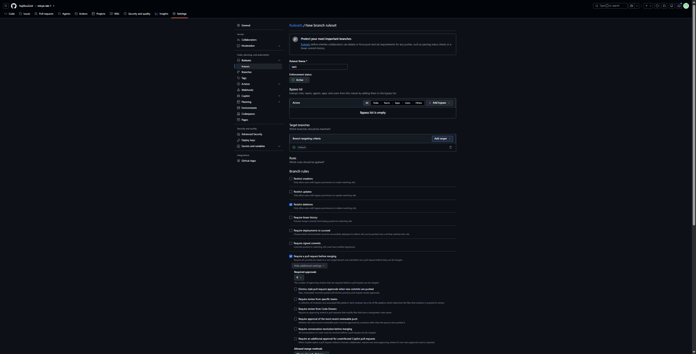

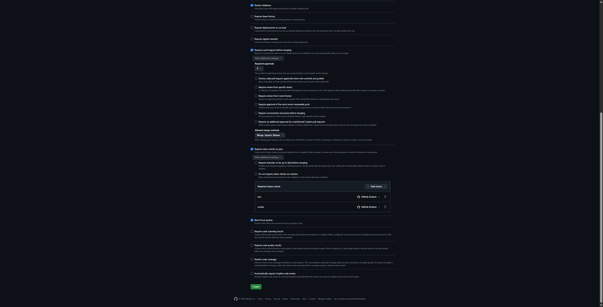

On branch `break-test`, `category_from_filename` was made to always return `"Bread"`. The pull request shows "Some checks were not successful": `ci / test` failing for both the `push` and `pull_request` events, with `smoke` and `push` skipped. Both `test` and `smoke` are marked **Required**, and the **Merge pull request** button is greyed out:

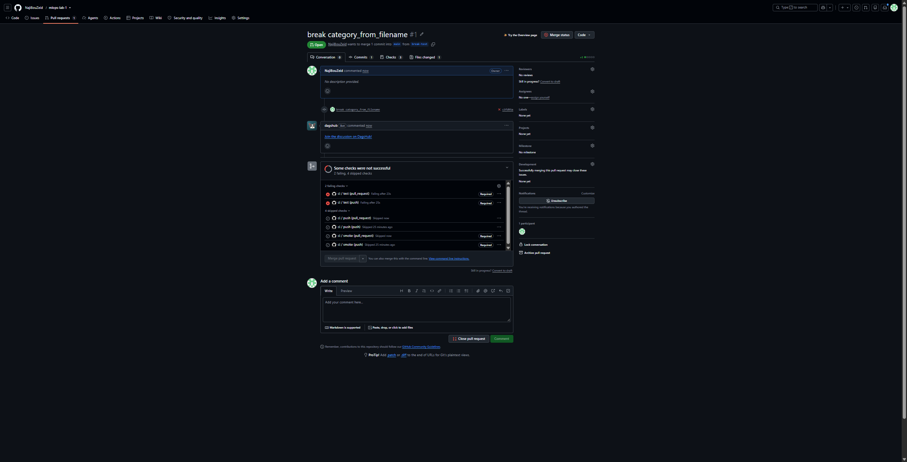

The `test` log shows the exact failure:

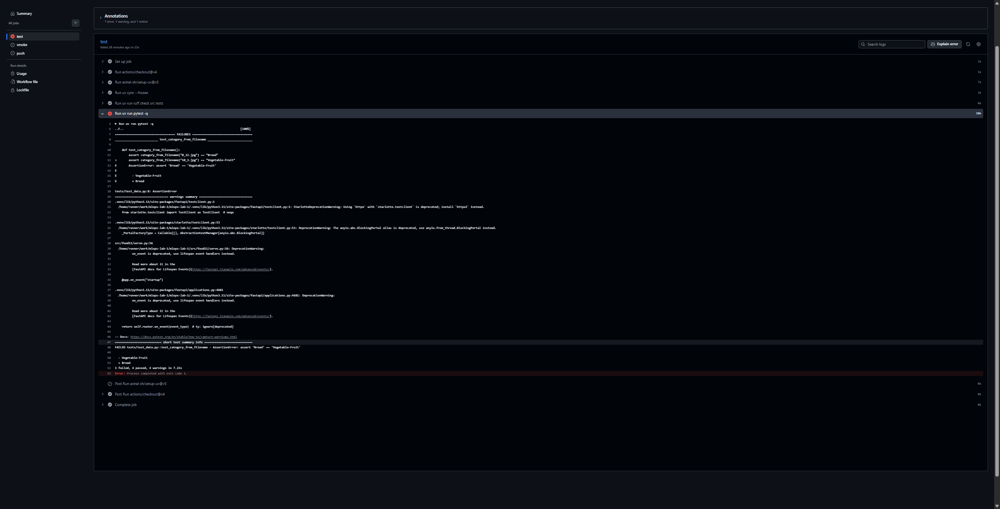

Merging was not possible: the bypass list is empty, so not even the repository owner can skip the rule. After the fix was pushed to the same branch, all checks passed and the merge was allowed:

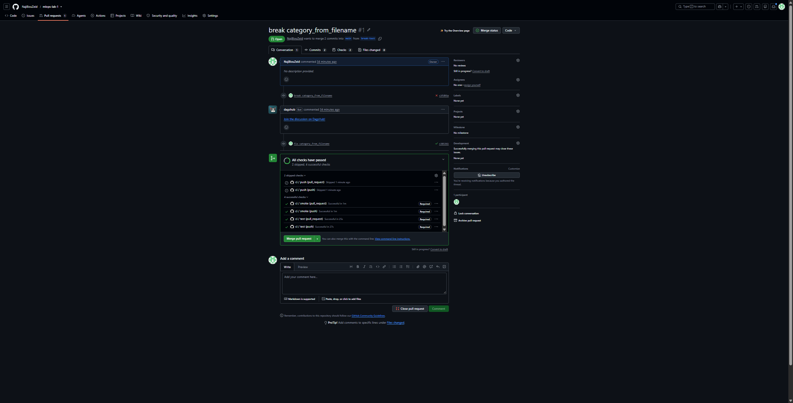

"Everybody runs the tests on their laptop" relies on discipline, and on every laptop having the same environment. People forget, skip slow tests under pressure, or have a local package version or file that makes the tests pass only on their machine. With required checks, the rule is enforced by the platform, in the same clean environment for everyone, from the locked `uv.lock`. `main` can only receive code that passed, reviewers see the result on the PR without running anything, and a broken commit is blocked before it can reach other people or the image registry.

## Question 10: For each candidate, what did the gate decide, and with which numbers? With your test-set size, how many accuracy points does `2 * se` represent?

Current champion: version 1 (`bright-colt-77`, `lr=0.0001`, 5 epochs, mini dataset), `test_accuracy = 0.7546`. Test split: `data/food11_processed_mini/evaluation`, n = 1096 images.

**Candidate A: version 2** (`tasteful-sheep-365`, `lr=0.00001`, 5 epochs), a deliberately weak model:

```
(mlops-lab-1) PS ...\mlops-lab-1> uv run python src/food11/promote.py --version 2
n (test images)       : 1096
champion              : v1  test_accuracy=0.7546  se=0.0130
candidate             : v2  test_accuracy=0.5119
threshold (champ+2se) : 0.7806
decision              : kept as challenger
```

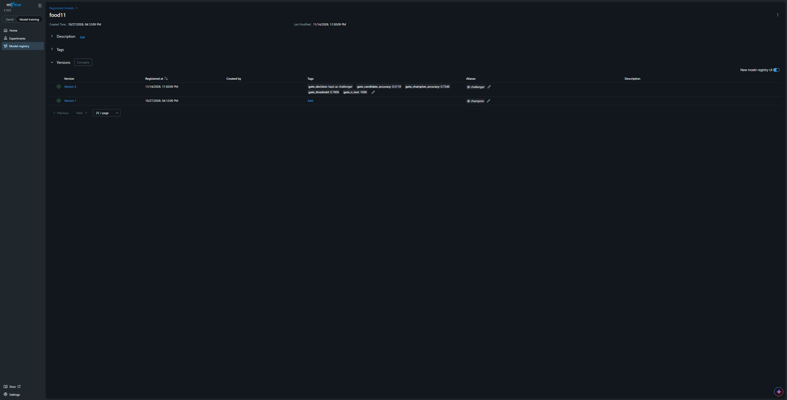

**Candidate B: version 3** (`clean-cod-763`, `lr=0.0001`, 10 epochs), the best settings trained longer:

```
(mlops-lab-1) PS ...\mlops-lab-1> uv run python src/food11/promote.py --version 3
n (test images)       : 1096
champion              : v1  test_accuracy=0.7546  se=0.0130
candidate             : v3  test_accuracy=0.7655
threshold (champ+2se) : 0.7806
decision              : kept as challenger
```

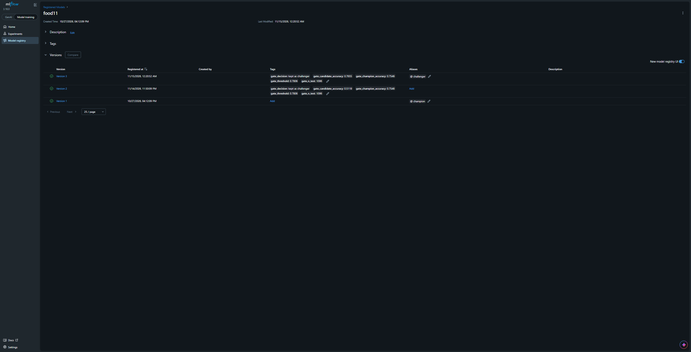

| Candidate | test_accuracy | Threshold | Decision |
|---|---|---|---|
| v2 (`lr=1e-5`) | 0.5119 | 0.7806 | kept as challenger |
| v3 (`lr=1e-4`, 10 epochs) | 0.7655 | 0.7806 | kept as challenger |

`champion` stayed on version 1 both times. The `challenger` alias moved from v2 to v3, and each candidate carries its decision and numbers as tags (`gate_decision`, `gate_candidate_accuracy`, `gate_champion_accuracy`, `gate_threshold`, `gate_n_test`).

With n = 1096 and p = 0.7546: se = √(0.7546 × 0.2454 / 1096) = 0.0130, so **2·se = 0.026, about 2.6 accuracy points**. v3 is 1.1 points better than the champion on paper. That is less than one standard error, so it is within the noise of a 1096-image test set, and the gate correctly refuses to replace the serving model for it.

## Question 11: `promote.py` needs to reach your MLflow server, so it cannot run in GitHub's cloud runners while MLflow lives on your laptop. Name two ways to make it run automatically after training. (Hint: DagsHub also offers a hosted MLflow server per repository.)

1. **Move the tracking server to DagsHub's hosted MLflow.** Point `MLFLOW_TRACKING_URI` to `https://dagshub.com/NajiBouZeid/mlops-lab-1.mlflow` and store the DagsHub token as GitHub secrets (`MLFLOW_TRACKING_USERNAME` / `MLFLOW_TRACKING_PASSWORD`). A GitHub Actions workflow can then reach the registry and run `promote.py`: started by `workflow_dispatch` from the training machine once a version is registered, by `repository_dispatch` from the training script, or on a `schedule` that checks every new version without a `gate_decision` tag.
2. **Run it on the machine that trains, as part of the training pipeline.** Either chain it after training (a DVC pipeline with `train` → `register` → `promote` stages, so `dvc repro` always ends with the gate, or `train.py` registering the model and calling the gate at the end), or install a **self-hosted GitHub Actions runner** on the laptop. That runner can reach `127.0.0.1:5000`, so a workflow job with `runs-on: self-hosted` can run `promote.py` while MLflow stays local.

## Question 12: Draw (in `lab/lab5.md`) the pipeline you now have, from `git push` to a running container. Mark which steps are automatic, which still need a human, and where the code version and the model version are decided.

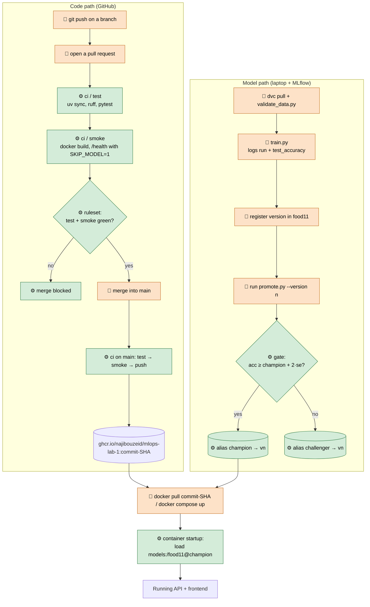

👤 = needs a human, ⚙️ = automatic.

| Step | Who | Decides |
|---|---|---|
| Lint, unit tests, smoke test on every push and PR | automatic (GitHub Actions) | whether the code is allowed into `main` |
| Merge of a green PR | human | **the code version**: the merge commit's SHA |
| Build and push of the image tagged with the SHA | automatic (`push` job on `main`) | the image that carries that code version |
| Data validation, training, registering a version | human (laptop, no GPU in CI) | – |
| Running `promote.py` | human starts it | – |
| Moving `champion` / `challenger` | automatic (the gate's rule) | **the model version**: whichever version `champion` points to |
| Deploying: `docker pull <SHA>` / `docker compose up` | human | which code version runs |
| Loading the model | automatic at container startup | resolves `champion` to a model version |

The two versions are decided independently. The code version is fixed when a PR is merged and identified by the image's SHA tag. The model version is fixed by the `champion` alias in the registry. A container built from one SHA can serve different models over time: moving `champion` and restarting the container is enough, with no rebuild. The steps that still need a human are merging, training and registering, starting the gate, and deploying. In the current Compose setup, the inference image is still built locally from the Dockerfile; referencing `ghcr.io/najibouzeid/mlops-lab-1:<SHA>` in `docker-compose.yml` would make the deployed code exactly the image CI tested.
